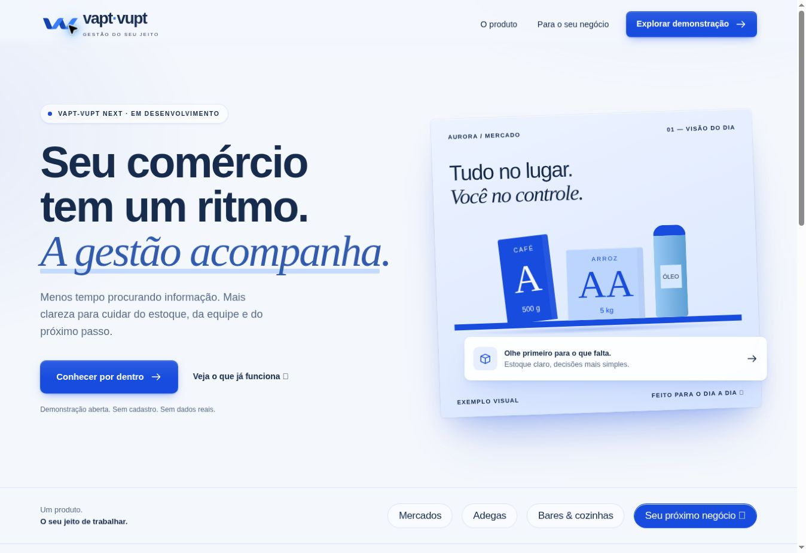

# Continuação do PR #8 — marca azul e responsividade

Base: `fd357008d40d5b85e2ed834ca098ea7b3bcac8bc`, após a integração do trabalho visual do Claude. Esta alteração mantém a composição, os componentes, a hierarquia e o movimento desse trabalho.

## Entrega

- Direção 03 do estudo de marca: VV em fitas contínuas, reconstruído em paths SVG. Símbolo azul, monocromático e reverso, wordmarks e favicon.
- Azul Royal, Azul Marinho e Azul Atlântico em três empresas fictícias, incluindo modo escuro. Alertas continuam com cores semânticas.
- Conversão das preferências antigas para as novas paletas sem apagar catálogo, saldos ou logotipos. O contrato v1 aceita os aliases anteriores.
- Cabeçalho, hero, seletor de empresa, grades, nomes longos, tabelas e formulários adaptados às telas estreitas. Rolagem da tabela permanece dentro da região acessível por teclado.

## Verificação local

| Comando / verificação | Resultado |
|---|---|
| `npm run lint` | Passou |
| `npm run build` | Passou; TypeScript e Vite |
| `node --import tsx --test tests/*.test.ts` | 6 passaram, 1 integração PostgreSQL ignorada sem banco de testes |
| `git diff --check` | Passou |
| Navegador na prévia local | Site, logo, aplicação e modo escuro conferidos |
| `npx playwright install chromium` | Download retornou arquivo inválido neste ambiente; matriz executada pelo CI do PR |

Os testes de navegador incluem 320, 360, 390, 768, 1024 e 1440 px, cor do botão, presença da marca, título sem corte, ausência de transbordamento da página, tabela contida, diálogo e migração das três paletas com preservação de saldo. A suíte existente mantém a verificação das operações demonstrativas.

## Limites

Esta é uma correção visual e de adaptação de layout. A demonstração continua explicitamente local, sem autenticação comercial nem sincronização. Não há alteração de permissões ou deploy de produção. O wordmark contém texto SVG com fallback de fonte; os símbolos são paths independentes de fonte. A verificação não equivale a uma auditoria WCAG completa.
